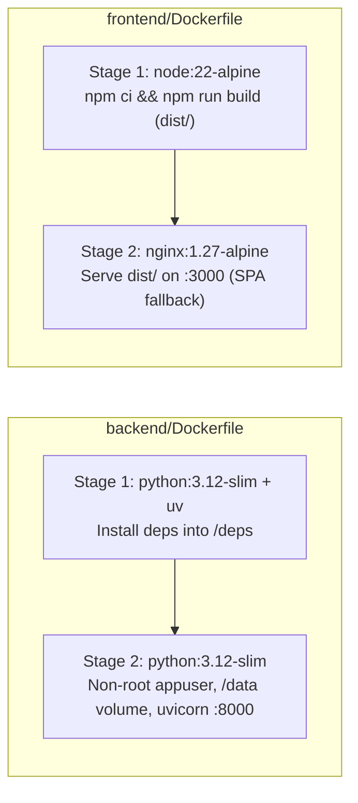
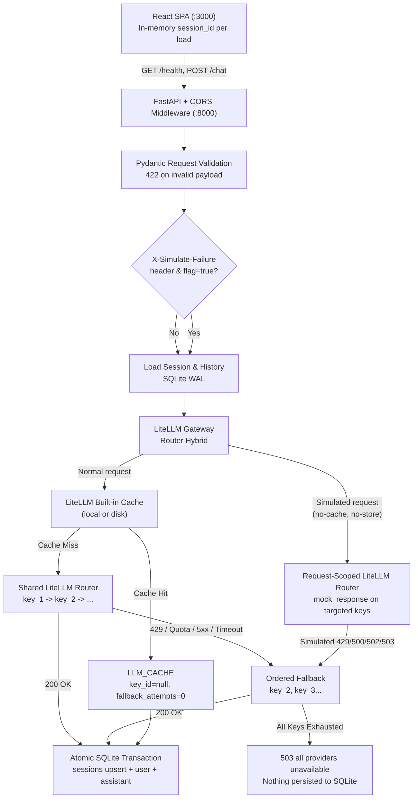
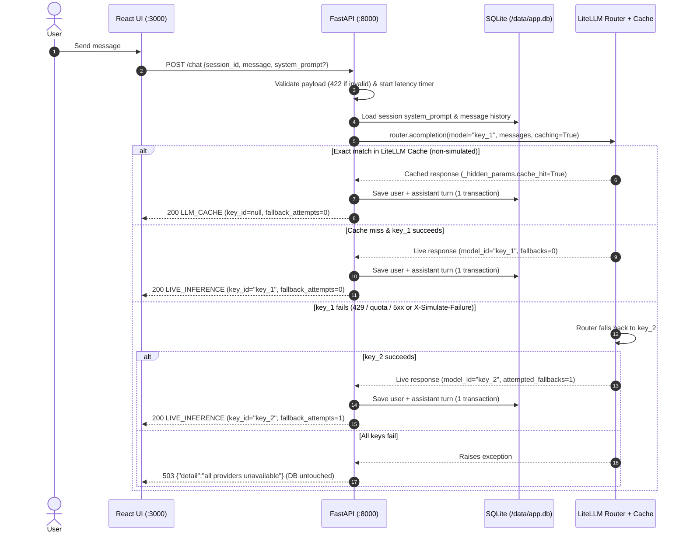
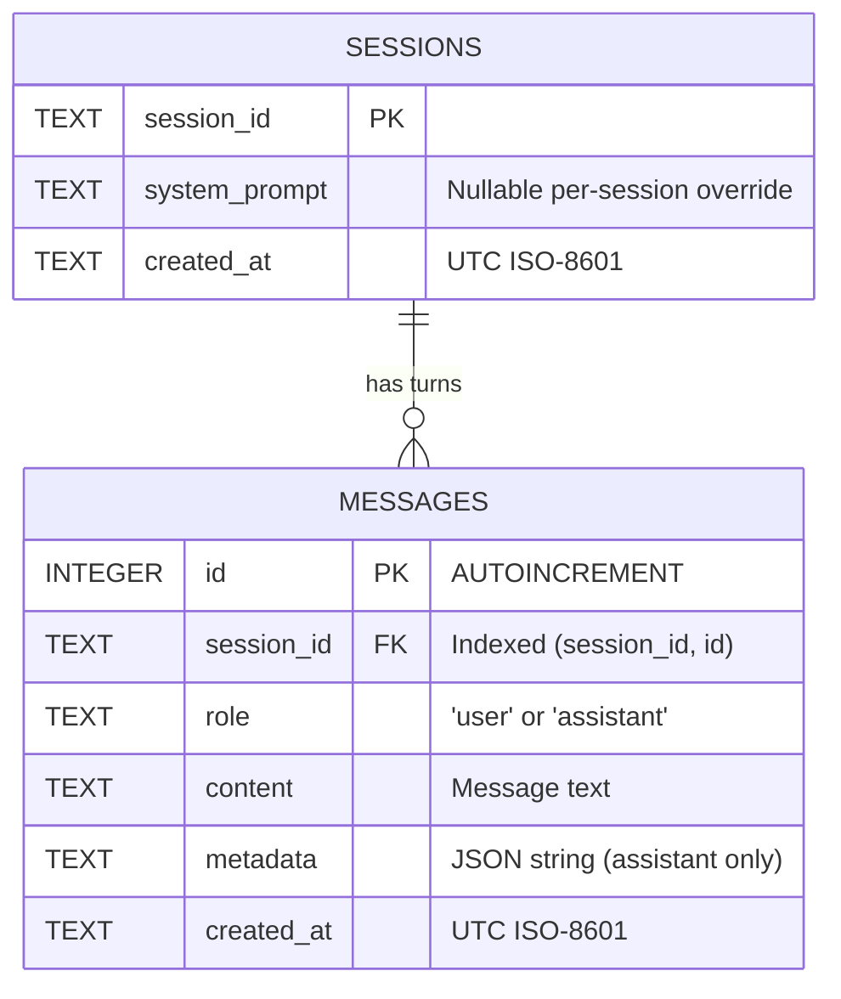

# Lyftr AI — Multi-Turn LLM Chatbot with Key Failover and Response Caching

An end-to-end, containerized **multi-turn LLM Chatbot** engineered for **deterministic API key failover**, **exact-match response caching**, **per-request token & latency observability**, and **persistent SQLite session storage** using **React (Vite + TypeScript)**, **FastAPI**, **LiteLLM**, and **SQLite**.

---

## 1. Live URLs

| Resource | URL | Notes |
|---|---|---|
| **Frontend (Vercel)** | https://lyftr-ai-chatbot-pearl.vercel.app | Public React SPA connected to live backend |
| **Backend (Railway)** | https://lyftrai-chatbot-production.up.railway.app | Docker container with persistent `/data` volume |
| **Backend Health Check** | https://lyftrai-chatbot-production.up.railway.app/health | Returns `200 {"status":"ok","keys_configured":2,"cache_enabled":true}` |
| **Public GitHub Repository** | https://github.com/Srijato-05/LyftrAI-Chatbot | Full source, tests, Dockerfiles, Compose, Makefile |
| **Demo Video (2–3 min)** | `TBD — add 2–3 min demo video link` | Narrated walkthrough of UI, caching, failover & endpoints |

> **Deployment Config:** Backend runs on Railway with `ENABLE_FAILURE_SIMULATION=true`, `/data` persistent volume, and `ALLOWED_ORIGINS` allowing `https://lyftr-ai-chatbot-pearl.vercel.app`.

---

## 2. Run locally

### Repository Structure

```text
.
├── backend/
│   ├── app/
│   │   ├── main.py              # FastAPI factory, lifespan, CORS, secret-redacting log filter
│   │   ├── config.py            # Pydantic Settings (LLM_API_KEYS, DATABASE_URL, CORS, etc.)
│   │   ├── schemas.py           # Strict request/response schemas & validation rules
│   │   ├── db.py                # Async SQLite (WAL) wrapper & transactional save_turn()
│   │   ├── errors.py            # JSON-only exception handlers (422, 404, 503, 500)
│   │   ├── routes.py            # GET /health, POST /chat, GET /sessions/{id}/messages
│   │   └── llm/
│   │       ├── gateway.py       # LiteLLM Router hybrid + Cache + metadata extraction
│   │       └── simulation.py    # X-Simulate-Failure parser & LiteLLM mock mapping
│   ├── tests/                   # 55 offline pytest tests (unit, contract, security, stress)
│   ├── scripts/spike_litellm.py # Phase-2 LiteLLM behavior verification spike
│   ├── pyproject.toml
│   ├── requirements.txt
│   ├── Dockerfile               # Multi-stage python:3.12-slim non-root runtime image
│   └── .dockerignore
├── frontend/
│   ├── src/
│   │   ├── App.tsx              # Session-per-load chat controller & error display
│   │   ├── api.ts               # Typed API client (VITE_API_BASE_URL)
│   │   ├── types.ts             # Shared TypeScript interfaces
│   │   ├── styles.css           # Responsive dark UI styles
│   │   └── components/
│   │       ├── Composer.tsx         # data-testid="chat-input", "send-button"
│   │       ├── MessageBubble.tsx    # data-testid="assistant-message", error alerts
│   │       ├── MetaBar.tsx          # meta-source, meta-model, meta-latency, meta-*-tokens
│   │       ├── SystemPromptPanel.tsx# Optional data-testid="system-prompt-input"
│   │       └── ErrorBoundary.tsx    # Root crash protection (never blank screen)
│   ├── nginx.conf               # Port 3000 SPA static server
│   ├── Dockerfile               # Multi-stage node:22-alpine -> nginx:1.27-alpine
│   └── .dockerignore
├── scripts/
│   ├── smoke.ps1                # End-to-end contract verifier (PowerShell)
│   └── smoke.sh                 # End-to-end contract verifier (Bash)
├── docker-compose.yml           # Backend (:8000) + Frontend (:3000) + lyftr_data:/data
├── Makefile                     # up, down, logs, test, dev-backend, dev-frontend, clean
├── .env.example                 # Template environment variables (zero real secrets)
├── .gitignore
└── README.md
```

### Prerequisites & API Key Setup

1. **Docker & Docker Compose v2** (for `make up` / `make down`), plus `make` (`winget install ezwinports.make` on Windows if not installed).
2. **At least 2 Gemini API keys from separate Google Cloud projects** (Google AI Studio enforces free-tier rate limits *per project*, so keys from two distinct projects provide truly independent quotas):
   - Visit [Google AI Studio API Keys](https://aistudio.google.com/apikey) → **Create API key** → **Create API key in new project** (copy as `key_1`).
   - Repeat → **Create API key in new project** a second time (copy as `key_2`).

---

### With Docker

1. **Create `.env` from `.env.example`** and insert your keys (real keys are gitignored and never committed):
   ```bash
   cp .env.example .env
   ```
   ```env
   LLM_API_KEYS=your_project_1_key,your_project_2_key
   LLM_MODEL=gemini/gemini-2.5-flash
   DATABASE_URL=sqlite:////data/app.db
   ALLOWED_ORIGINS=http://localhost:3000
   ENABLE_FAILURE_SIMULATION=true
   VITE_API_BASE_URL=http://localhost:8000
   ```

2. **Build and start the full stack:**
   ```bash
   make up
   ```
   - Backend API: `http://localhost:8000` (healthcheck polled automatically)
   - Frontend UI: `http://localhost:3000` (waits until backend `/health` is healthy)
   - SQLite DB: persisted inside the Docker named volume `lyftr_data` mounted at `/data` (`/data/app.db`).

3. **Inspect logs or stop containers:**
   ```bash
   make logs     # Tail backend & frontend container logs
   make down     # Stop containers while preserving SQLite history in lyftr_data
   make clean    # Stop containers AND delete the lyftr_data volume
   ```

#### Docker Multi-Stage Build Pipeline



---

### Without Docker

#### 1. Backend (Python 3.12 + `uv`)
```bash
cd backend
uv sync
```
Configure local environment variables (PowerShell example):
```powershell
$env:LLM_API_KEYS = "your_key_1,your_key_2"
$env:LLM_MODEL = "gemini/gemini-2.5-flash"
$env:DATABASE_URL = "sqlite:///./app.db"
$env:ALLOWED_ORIGINS = "http://localhost:3000"
$env:ENABLE_FAILURE_SIMULATION = "true"
uv run uvicorn app.main:app --reload --port 8000 --workers 1
```

#### 2. Frontend (Node.js 20+)
```bash
cd frontend
npm install
npm run dev -- --port 3000
```

#### 3. Run the Backend Test Suite (Offline, 55 Tests)
```bash
make test
# or directly:
cd backend && uv run pytest -v
```

---

### Environment Variables Reference

| Variable | Scope | Required | Default | Purpose |
|---|---|---|---|---|
| `LLM_API_KEYS` | Backend | **Yes** | — | Comma-separated pool of $\ge 2$ API keys, mapped in order to `key_1`, `key_2`, ... |
| `LLM_MODEL` | Backend | No | `gemini/gemini-2.5-flash` | LiteLLM model identifier applied across keys |
| `LLM_MODELS` | Backend | No | `None` | Optional comma-separated per-key model overrides matching `LLM_API_KEYS` order |
| `DATABASE_URL` | Backend | **Yes** | `sqlite:////data/app.db` | SQLite location (`sqlite:////data/app.db` inside Docker volume) |
| `ALLOWED_ORIGINS` | Backend | **Yes** | `http://localhost:3000` | Comma-separated allowed CORS origins (no trailing slashes) |
| `ENABLE_FAILURE_SIMULATION` | Backend | No | `false` | Set `true` to honor the `X-Simulate-Failure` header (must be `true` in deployment) |
| `DEFAULT_SYSTEM_PROMPT` | Backend | No | `You are a helpful assistant.` | Fallback system prompt if none is set for a session |
| `CACHE_TYPE` | Backend | No | `local` | LiteLLM cache backend: `local` (in-memory) or `disk` |
| `CACHE_DIR` | Backend | No | `/data/llm_cache` | Directory path when `CACHE_TYPE=disk` |
| `LLM_TIMEOUT_SECONDS` | Backend | No | `30.0` | Per-attempt timeout passed to LiteLLM `Router` |
| `LLM_TEMPERATURE` | Backend | No | `0.7` | Fixed sampling temperature so generation params never split cache keys |
| `MAX_HISTORY_MESSAGES` | Backend | No | `50` | Max stored messages included in LLM context (full history stays in SQLite) |
| `PORT` | Backend | No | `8000` | Listening port (automatically injected by Railway/Docker) |
| `VITE_API_BASE_URL` | Frontend | **Yes** | `http://localhost:8000` | Backend base URL baked into the Vite bundle at build time |

---

## 3. Design decisions

### System Architecture



### Request Lifecycle & Failover Sequence



---

### Key fallback

1. **LiteLLM `Router` Hybrid (`backend/app/llm/gateway.py`):**
   - Each key in `LLM_API_KEYS` is registered as its own deployment in `litellm.Router` (`model_name="key_1"`, `"key_2"`, ..., with `model_info={"id": key_id}`), chained via explicit ordered `fallbacks=[{"key_1": ["key_2", ...]}]`, `num_retries=0`, and `cooldown_time=0`.
   - **Why this hybrid over default `simple-shuffle`:**
     - Using `litellm.Router` guarantees LiteLLM itself owns provider dispatch, error classification (`RateLimitError`, `InternalServerError`, `ServiceUnavailableError`, `APIConnectionError`, `Timeout`, `AuthenticationError`), and fallback execution.
     - Assigning each key a sequential `model_name` (`key_1`, `key_2`, ...) guarantees **deterministic order** (`key_1` is always tried first, then `key_2`, etc.) instead of random shuffling.
     - Setting `cooldown_time=0` ensures a transient or simulated error on `key_1` never locks out `key_1` on subsequent independent requests.
   - **Exact `key_id` and `fallback_attempts` extraction:** After `router.acompletion()` succeeds, `gateway.py` reads `resp._hidden_params["model_id"]` for the winning `key_id` and `resp._hidden_params["additional_headers"]["x-litellm-attempted-fallbacks"]` for `fallback_attempts` (verified in `backend/scripts/spike_litellm.py`).
   - **Clean `503` failure:** If every key fails or returns empty text, `AllProvidersUnavailable` maps to HTTP `503 {"detail": "all providers unavailable"}`.

2. **Per-Request `X-Simulate-Failure` Hook (`backend/app/llm/simulation.py`):**
   - Honored **only** when `ENABLE_FAILURE_SIMULATION=true`.
   - Parses comma-separated `<key_id>=<status>` pairs (`429`, `500`, `502`, `503`; `*` expands to all configured keys). Malformed pairs or unknown keys are safely ignored so bad headers never crash chat.
   - Builds a **request-scoped `Router`** injecting LiteLLM's native `mock_response` error strings (`"litellm.RateLimitError"` for `429`, `"litellm.InternalServerError"` for `500`/`502`/`503`) on targeted keys—routing simulated failures through LiteLLM's real exception & fallback pipeline while keeping state isolated to that single request.

3. **Secret Protection (`backend/app/main.py`):**
   - During testing, we observed LiteLLM's internal `DEBUG` logger prints `api_key='...'`. We installed `_SecretRedactingFilter` on the root logger and handlers to replace all configured API keys with `***REDACTED***`, and raised `LiteLLM*` logger levels to `WARNING`. Raw keys never appear in responses, logs, or SQLite.

---

### Caching

1. **LiteLLM Built-In Cache (`litellm.Cache`):**
   - Initialized at startup via `litellm.cache = Cache(type="local")` (or `type="disk"` at `CACHE_DIR` when `CACHE_TYPE=disk`).
   - LiteLLM computes an exact-match hash over `(model, messages, temperature, ...)` where `messages` is `[system_prompt] + stored_history + [new_user_message]`. API keys are **excluded** from the cache key, matching the spec rule that identical first prompts in separate sessions return `LLM_CACHE`.
   - On a hit (`resp._hidden_params.get("cache_hit") is True`), `gateway.py` sets `resolution_source = "LLM_CACHE"`, `key_id = None`, `fallback_attempts = 0`, and returns the stored reply and per-request `input_tokens`/`output_tokens`.
2. **Cache vs. Simulation Collision Prevention:**
   - If a prompt is already cached and a test sends `X-Simulate-Failure: key_1=429` or `*=429`, reading from cache would return `200 LLM_CACHE` instead of exercising failover or `503`. When simulation is active for a request, `gateway.py` passes `cache={"no-cache": True, "no-store": True}` so cached responses are bypassed and simulated runs never pollute the cache.
3. **LiteLLM Version Pin (`litellm>=1.70.0,<1.75.0` + `orjson`):**
   - Our Phase 2 spike caught a packaging regression in `litellm==1.110.3` where cache hits transitively imported `litellm.proxy` → `soundfile`. Pinning `1.74.15.post2` (with `orjson>=3.10.0` and `LITELLM_LOCAL_MODEL_COST_MAP=True`) resolved cache hits cleanly with fast offline startup and a compact Docker image.
4. **Single Uvicorn Worker (`--workers 1`):**
   - Ensures all requests share the same in-memory `litellm.Cache` process state.

---

### SQLite session storage



- **Zero External Databases:** Pure stdlib `sqlite3` (wrapped in `asyncio.to_thread`) with `PRAGMA journal_mode=WAL` for non-blocking concurrent reads and writes.
- **Auto-Initialized Schema:** Tables and `idx_messages_session` are created automatically on startup at the path resolved from `DATABASE_URL` (`sqlite:////data/app.db`).
- **Atomic Turn Persistence:** `db.save_turn()` upserts `sessions` and inserts both the `user` and `assistant` rows inside **one transaction**, executed **only after** a `200` LLM reply is obtained. Failed `422` and `503` requests never create a session or write partial messages.
- **History Endpoint Filtering:** `GET /sessions/{session_id}/messages` returns rows ordered by `id ASC`, omitting `system_prompt` and omitting `metadata` on `user` rows.

---

### API & Frontend Contract Summary

| Endpoint | Behavior |
|---|---|
| `GET /health` | Pings SQLite (`SELECT 1`); returns `200 {"status":"ok","keys_configured":N,"cache_enabled":true}` or `503 {"detail":"database unavailable"}` |
| `POST /chat` | Validates `session_id` (1–128 chars, preserved verbatim) & `message` (1–4000 chars trimmed); optional `system_prompt`; returns `session_id`, `reply`, and `metadata` (`resolution_source`, `model`, `latency_ms`, `input_tokens`, `output_tokens`, `key_id`, `fallback_attempts`) |
| `GET /sessions/{session_id}/messages` | Oldest-first history without system prompt, or `404 {"detail":"session not found"}` |
| Errors (`422`, `404`, `503`, `500`) | Strictly JSON `{"detail": ...}`; never stack traces or HTML |

**Frontend `data-testid` Contract:** `chat-input` (cleared on send), `send-button`, `assistant-message` (containing `meta-source`, `meta-model`, `meta-latency`, `meta-input-tokens`, `meta-output-tokens`), and `system-prompt-input` (optional). A new `session_id` is generated in memory on every page load, and `422`/`503`/network failures render inline in the chat thread.

---

## 4. Verification

### 1. Automated Backend Test Suite (`55 passed`)

All 55 tests run offline against an isolated temporary SQLite DB and mocked HTTP transport (`AsyncHTTPHandler.post`), verifying real LiteLLM `Router` + `Cache` behavior without burning API quota:

| Test File | Coverage |
|---|---|
| `test_health.py` | `200` health shape, DB failure → `503` JSON |
| `test_validation.py` | Missing fields, whitespace, `4000` vs `4001` boundary, `128` vs `129` `session_id`, bad JSON → `422` + no DB write |
| `test_chat.py` | Exact `POST /chat` contract, verbatim `session_id` echo, integer types |
| `test_cache.py` & `test_cache_exhaustive.py` | Cross-session first-message `LLM_CACHE`, `key_id: null`, speed vs live delay, `system_prompt` cache splitting, multi-turn cache replay, `no-store` under simulation |
| `test_failover.py` & `test_failover_exhaustive.py` | `key_1=429/500/502/503` → `key_2`, 3-key chain (`fallback_attempts=2`), `*=429` → `503`, flag-disabled ignore, real HTTP `429/5xx/401/403` & `ConnectError`/`ReadTimeout`, `LLM_MODELS` override, empty pool |
| `test_sessions.py` & `test_persistence_and_concurrency.py` | `404` unknown session, oldest-first ordering, session isolation, per-request token math, `system_prompt` persistence, SQLite schema/restart persistence, `MAX_HISTORY_MESSAGES`, 10-session concurrency |
| `test_edge_cases_and_security.py` | Zero secret leakage in responses/logs/SQLite, CORS preflight, JSON `404`/`405`/`500`, empty provider reply → `503`, Unicode/emojis/SQLi strings |
| `test_config.py`, `test_grader_contract.py`, `test_simulation_parser.py`, `test_stress_and_fuzz.py` | Settings URL parsing, full Grader Probe Matrix, adversarial headers/types, 30-request mixed-workload async concurrency stress, 10-turn growth |

Run locally:
```bash
cd backend && uv run pytest -v
```

### 2. One-Command Contract Smoke Script (Local or Live)

Runs end-to-end checks for `/health`, `LIVE_INFERENCE`, `LLM_CACHE` hit + latency comparison, multi-turn `input_tokens` growth, `X-Simulate-Failure: key_1=429` → `key_2`, `*=429` → `503` (404 history check), `422` validation, and `/sessions/{id}/messages`:

```powershell
# PowerShell (against local Docker or deployed Railway URL)
.\scripts\smoke.ps1 -Base http://localhost:8000
.\scripts\smoke.ps1 -Base https://lyftrai-chatbot-production.up.railway.app
```
```bash
# Bash
./scripts/smoke.sh http://localhost:8000
```

### 3. Manual `curl` Verification Commands

```bash
# 1. Health check
curl -s http://localhost:8000/health

# 2. Live inference (turn 1 in session s-v1)
curl -s -X POST http://localhost:8000/chat \
  -H "Content-Type: application/json" \
  -d '{"session_id":"s-v1","message":"What is the capital of France?"}'

# 3. Cache hit in a brand-new session s-v2 (expect resolution_source=LLM_CACHE, key_id=null, lower latency_ms)
curl -s -X POST http://localhost:8000/chat \
  -H "Content-Type: application/json" \
  -d '{"session_id":"s-v2","message":"What is the capital of France?"}'

# 4. Multi-turn context & per-request token growth (turn 2 in session s-v1)
curl -s -X POST http://localhost:8000/chat \
  -H "Content-Type: application/json" \
  -d '{"session_id":"s-v1","message":"What river runs through it?"}'

# 5. Failover test: key_1=429 -> key_2 answers (fallback_attempts=1)
curl -s -X POST http://localhost:8000/chat \
  -H "Content-Type: application/json" \
  -H "X-Simulate-Failure: key_1=429" \
  -d '{"session_id":"s-v3","message":"Say hello in 3 words."}'

# 6. Exhaustion test: *=429 -> HTTP 503 {"detail":"all providers unavailable"} & nothing written to SQLite
curl -i -X POST http://localhost:8000/chat \
  -H "Content-Type: application/json" \
  -H "X-Simulate-Failure: *=429" \
  -d '{"session_id":"s-v-fail","message":"Should fail"}'
curl -i http://localhost:8000/sessions/s-v-fail/messages

# 7. Session history (oldest-first, no system prompt)
curl -s http://localhost:8000/sessions/s-v1/messages

# 8. Validation error (empty/whitespace message -> 422 JSON)
curl -i -X POST http://localhost:8000/chat \
  -H "Content-Type: application/json" \
  -d '{"session_id":"s-bad","message":"   "}'
```

### 4. Docker Volume Persistence & UI Verification

- **Persistence across container restarts:**
  1. Start with `make up`, send a message in session `s-persist`, verify `GET /sessions/s-persist/messages` returns `200`.
  2. Run `make down && make up`.
  3. Call `GET /sessions/s-persist/messages` again — returns the exact stored history from the `lyftr_data:/data` volume.
- **Per-message token usage & caching in the UI (`http://localhost:3000`):**
  1. Send a message; confirm `chat-input` clears and the reply displays `LIVE_INFERENCE`, model name, `latency_ms`, `input_tokens`, and `output_tokens` for that single request.
  2. Send a follow-up; confirm `input_tokens` reflects the growing conversation context (not a cumulative sum of all prior requests' output + input).
  3. Reload the page (starts a new `session_id`) and send the identical first message; confirm the badge switches to `LLM_CACHE` with lower latency.

### 5. Production Deployment Steps (Railway + Vercel)

1. **Backend on Railway:** New Project → Deploy from GitHub → **Root Directory:** `backend` (builds `backend/Dockerfile`) → attach a **Volume** at `/data` → set `LLM_API_KEYS`, `LLM_MODEL=gemini/gemini-2.5-flash`, `DATABASE_URL=sqlite:////data/app.db`, `ENABLE_FAILURE_SIMULATION=true`, `ALLOWED_ORIGINS` → Healthcheck `/health` → generate public domain.
2. **Frontend on Vercel:** Import GitHub repo → **Root Directory:** `frontend` (Vite preset) → set `VITE_API_BASE_URL=https://<railway-domain>` → Deploy → add Vercel URL to Railway's `ALLOWED_ORIGINS`.

---

## 5. Setup Used

- **Operating System:** Windows 11
- **Editor / IDE:** Antigravity / VS Code
- **AI Coding Assistant:** Antigravity (planning, LiteLLM behavior spike verification, backend/frontend implementation, and test generation)
- **Languages & Tooling:** Python 3.12 (`uv`, `FastAPI`, `LiteLLM`, `pytest`), TypeScript / React 18 (`Vite 6`, `Node.js 24`), Docker & Docker Compose v2

---

## 6. Bonus features (if any)

| Feature | Where | Why it was added |
|---|---|---|
| **55-test offline pytest suite** | `backend/tests/` | Exercises contract edge cases, 3-key failover, real HTTP/transport errors, cache key splitting, SQLite restart persistence, and 30-request concurrency stress without burning API quota |
| **Log secret-redaction filter** | `backend/app/main.py` | Prevents third-party LiteLLM debug logs from ever exposing configured API keys (`***REDACTED***`) |
| **Contract smoke scripts** | `scripts/smoke.ps1`, `scripts/smoke.sh` | One-command end-to-end verification against both local Docker (`:8000`) and live Railway deployments |
| **Collapsible system-prompt panel** | `frontend/src/components/SystemPromptPanel.tsx` | Implements the optional `data-testid="system-prompt-input"` contract cleanly without cluttering the chat composer, persisted per session in SQLite |
| **Extra UI observability** | `MetaBar.tsx`, `App.tsx`, `ErrorBoundary.tsx` | Displays `key_id` & `fallback_attempts` chips next to each reply, live `/health` status in the header, and a root `ErrorBoundary` so the UI never blanks |
| **Multi-model & disk-cache config** | `backend/app/config.py`, `gateway.py` | Supports per-key model overrides (`LLM_MODELS`), `MAX_HISTORY_MESSAGES` context windowing (preserving full DB history), and `CACHE_TYPE=disk` |
